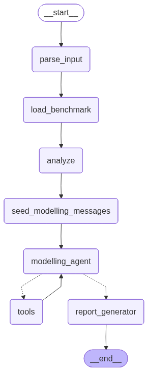

# Autonomous Polaris Agent

An autonomous agent that takes a natural language request (e.g. a Polaris benchmark URL and number of models), plans and runs multiple ML pipelines end-to-end, evaluates them, and produces a short report and artifacts. Built with LangGraph and OpenAI.

The agent runs without manual intervention beyond initial configuration. It parses user intent, loads Polaris chemistry benchmarks, plans domain-appropriate pipelines (fingerprints, models, metrics), executes them sequentially while using prior results to inform the next choice, and writes a structured report with artifact links. Single-command reproducibility is supported via `uv`.

## Environment setup

- **Python**: 3.12+
- **Package manager**: [uv](https://github.com/astral-sh/uv) (recommended)

```bash
# Clone and enter the project
cd autonomous-polaris-agent

# Install dependencies (creates venv and installs with uv)
uv sync

# Copy env example and set your OpenAI API key
cp .env.example .env
# Edit .env: set OPENAI_API_KEY=your_key_here
# Optional: OPENAI_MODEL=gpt-5.4 (default)
```

**macOS (XGBoost / LightGBM):** If you want the agent to use XGBoost or LightGBM, install the OpenMP runtime so their native libs can load:

```bash
brew install libomp
```

Without it, those two model types are skipped at import; the rest of the agent works normally.

## Run (single command)

The entire workflow runs without manual intervention after you invoke:

```bash
uv run python main.py "Generate 4 different regression models on https://polarishub.io/benchmarks/polaris/adme-fang-solu-1. Save the models and give me a report on their performance on the validation set."
```

Each run gets a **timestamped directory** under `outputs/` (e.g. `outputs/run_20260308_150530/`). Everything for that run lives there. A Rich console stdout keeps user informed on the execution flow (steps, tool calls, results) as the agent runs.

## Example datasets

- [polaris/adme-fang-solu-1](https://polarishub.io/benchmarks/polaris/adme-fang-solu-1)
- [tdcommons/caco2-wang](https://polarishub.io/benchmarks/tdcommons/caco2-wang)

## Work directory structure

```
autonomous-polaris-agent/
├── main.py                    # CLI entry (delegates to cli)
├── pyproject.toml             # uv/pip deps
├── .env.example               # OPENAI_API_KEY, OPENAI_MODEL
├── assets/
│   └── graph.png             # Agent workflow diagram (LangGraph-generated)
├── src/autonomous_polaris_agent/
│   ├── __init__.py
│   ├── __main__.py            # python -m autonomous_polaris_agent
│   ├── cli.py                 # argparse, delegates to run_agent
│   ├── run.py                 # run_agent: creates output dir, invokes graph
│   ├── graph.py               # LangGraph workflow (parse→load→analyze→ReAct→report)
│   ├── state.py               # AgentState, ParsedRequest, RunResult, etc.
│   ├── prompts.py             # Centralized prompts (parse, analysis, modelling, report)
│   ├── console.py             # Rich console output
│   ├── polaris_helpers.py     # Polaris slug resolution, load, evaluate
│   └── tools/
│       ├── __init__.py        # Public tool exports
│       ├── agent_tools.py     # LangChain tools + dispatch_tool (stateful executors)
│       ├── featurizers.py     # Morgan, RDKit descriptors, MACCS, atom_pair
│       ├── ml_tools.py        # train_and_predict, evaluate, save_model, save_plot
│       └── polaris_tools.py   # load_benchmark, evaluate_predictions
└── outputs/
    └── run_YYYYMMDD_HHMMSS/   # Per-run timestamped directory
        ├── report.md          # Final report (≤3 pages)
        ├── run.jsonl          # Structured log (tool_or_step, args, result, timestamp)
        └── artifacts/
            ├── model_0.joblib, model_1.joblib, ...
            ├── train_target_hist_*.png, test_predictions_hist_*.png
            ├── cv_results_*.png (when use_cv)
            └── metrics_comparison.png
```

## Agent architecture

- **Entry flow**: `main.py` → `cli.main()` → `run_agent()` in [run.py](src/autonomous_polaris_agent/run.py).
- **Graph**: LangGraph `StateGraph(AgentState)` in [graph.py](src/autonomous_polaris_agent/graph.py).
- **State**: TypedDict `AgentState` in [state.py](src/autonomous_polaris_agent/state.py) with `messages`, `benchmark`, `completed_runs`, `thought_process`, `logs`, etc.
- **Tools**: LangChain tools in [agent_tools.py](src/autonomous_polaris_agent/tools/agent_tools.py) bound to LLM; `dispatch_tool` routes to stateful executors that call [ml_tools.py](src/autonomous_polaris_agent/tools/ml_tools.py) and [polaris_tools.py](src/autonomous_polaris_agent/tools/polaris_tools.py).



## Workflow: how it works

1. **Parse** – LLM extracts `dataset_slug`, `num_models`, `task_type`, `save_models` from natural language (handles URLs like `https://polarishub.io/benchmarks/polaris/adme-fang-solu-1`).
2. **Load** – Polaris `load_benchmark(slug)` via [polaris_helpers.py](src/autonomous_polaris_agent/polaris_helpers.py); metadata (n_train, n_test, target_types, main_metric) stored in state.
3. **Analyze** – LLM produces task analysis (strategy, fingerprint/model choices, prediction_format) from metadata.
4. **ReAct loop** – Modelling agent receives tools (`list_available_models`, `train_and_predict`, `evaluate_predictions`, `create_ensemble_predictions`, `finish_and_report`). It runs N distinct pipelines sequentially, using prior run metrics to decide the next pipeline. Each `train_and_predict` call: featurize → (optional CV) → fit → predict on test → evaluate → save model/plots.
5. **Report** – LLM generates Markdown report from `task_analysis`, `thought_process`, `completed_runs`; writes `report.md` and embeds `metrics_comparison.png`.

## Design decisions

| Decision | Rationale |
|----------|-----------|
| **LangGraph** | Supports stateful multi-step workflows, conditional edges, and checkpointing. |
| **ReAct-style modelling agent** | Agent reasons before each tool call; uses prior run results to choose next pipeline (state across iterations). |
| **Polaris integration** | Uses `polaris-lib` for benchmark loading and evaluation; slug resolution handles URLs and short names. |
| **Domain-appropriate choices** | Fingerprints (Morgan, RDKit descriptors, MACCS, atom_pair) and models (ridge, RF, XGBoost, LightGBM) chosen by LLM from task analysis; `prediction_format` inferred from `main_metric` (roc_auc → probabilities). |
| **Structured logs (run.jsonl)** | Assignment requires logs of plans, tool calls, results; JSONL format for easy parsing and inspection. |
| **Timestamped output dirs** | Each run isolated; artifacts and report persist for later inspection. |
| **Single command** | `uv run python main.py "..."` runs the full workflow; no manual steps. |
| **Modular tools** | `featurizers.py` (RDKit), `ml_tools.py` (sklearn/XGBoost/LightGBM), `polaris_tools.py` (Polaris API) separated for clarity and testability. |

## Assignment alignment

| Requirement | Implementation |
|-------------|----------------|
| Autonomous execution | Full graph runs without human intervention. |
| X different pipelines | `num_models` parsed from user; agent must run exactly N distinct pipelines before `finish_and_report`. |
| State across iterations | `completed_runs`, `thought_process`, `messages` in `AgentState`. |
| LangGraph | Used for workflow orchestration. |
| Minimal deps | RDKit, scikit-learn, matplotlib, polaris-lib; XGBoost/LightGBM optional (libomp on macOS). |
| Short report (≤3 pages) | `REPORT_FINAL` prompt enforces max 3 pages. |
| Artifact links | Report includes paths to models and plots. |
| Domain-appropriate modeling | Task analysis + modelling agent prompts guide fingerprint/model/metric choices. |
| Reproducible single command | `uv run python main.py "..."`. |
| Structured logs | `run.jsonl` with `tool_or_step`, `args_summary`, `result_summary`, `timestamp`. |
| Persisted artifacts | Models and plots saved under `outputs/run_*/artifacts/`. |

## Output structure

Each run produces a timestamped directory under `outputs/`:

- **report.md** – Final report (≤3 pages) with: dataset and task, approach, reasoning and decisions, results table, artifact links. When the user asks for "validation set" performance, that is the held-out evaluation set from the benchmark.
- **run.jsonl** – One JSON object per line: `tool_or_step`, `args_summary`, `result_summary`, `timestamp`.
- **artifacts/** – Saved models (`model_0.joblib`, …), train/test histograms, CV results (when `use_cv`), and `metrics_comparison.png` (bar chart of primary metric per run).
