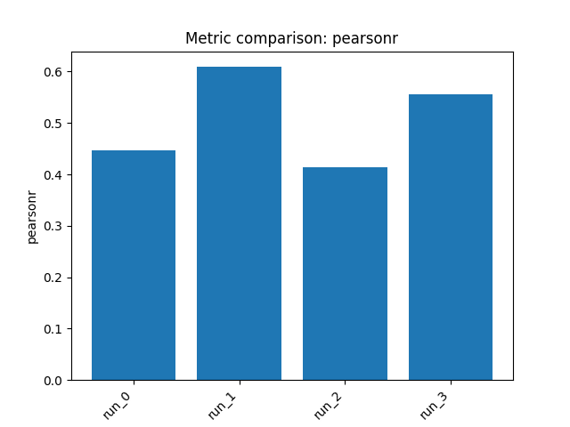

# Chemistry ML Agent Report: Polaris ADME Fang Solubility

## 1) Dataset and task

- **Benchmark:** `polaris/adme-fang-solu-1`
- **Endpoint / target:** **LOG_SOLUBILITY** (aqueous solubility on a log scale)
- **Task type:** **Single-task regression**
- **Data split used:** 1,578 training compounds and 400 held-out test compounds from the benchmark split

**Important note:** the reported “validation set” performance requested by the user corresponds to the benchmark’s **held-out evaluation set**, i.e. the **test split returned by `get_train_test_split`**. All metrics below are on that held-out evaluation/validation set.

---

## 2) Approach

I trained **4 different regression pipelines** as requested.

**High-level strategy**
- Use complementary chemical representations:
  - **Morgan fingerprints / counts** for substructure information
  - **RDKit descriptors** for global physicochemical properties
  - **Morgan + RDKit concatenation** to combine both views
- Use a mix of model classes:
  - **Linear baseline**: Ridge
  - **Kernel nonlinear model**: SVR
  - **Tree/boosting models**: XGBoost, LightGBM
- Optimize primarily for **Pearson correlation (`pearsonr`)**, which is the benchmark’s main metric.

---

## 3) Reasoning and decisions

- Solubility is influenced by both **local structural motifs** and **global physicochemical balance**, so hybrid features were prioritized early.
- Started with **Morgan+RDKit + Ridge** as a stable baseline to test whether a mostly linear relationship could capture the endpoint.
- After the linear model underperformed, moved to **XGBoost on the same concatenated features** to model nonlinear interactions between descriptors and substructures.
- To test whether solubility could be captured mostly by physicochemical descriptors, tried **RDKit descriptors + LightGBM**; this underperformed relative to hybrid features.
- Because descriptor-only learning was weaker, the final run emphasized structural detail with **Morgan count fingerprints + SVR**, which improved over the linear and descriptor-only baselines.
- Overall takeaway from the sweep: **combining structural fingerprints with descriptors was most effective**, and **nonlinear models outperformed the linear baseline** on this benchmark.

---

## 4) Results

### Summary
All metrics below are on the **held-out evaluation (validation) set**.

| Model ID | Pipeline | Pearson r | Spearman r | MAE | MSE | R² |
|---|---|---:|---:|---:|---:|---:|
| `run_0` | morgan_rdkit_concat + ridge | 0.447 | 0.344 | 0.590 | 0.605 | -0.116 |
| `run_1` | morgan_rdkit_concat + xgboost | **0.609** | **0.527** | **0.403** | **0.343** | **0.367** |
| `run_2` | rdkit_descriptors + lightgbm | 0.414 | 0.374 | 0.461 | 0.451 | 0.168 |
| `run_3` | morgan_counts + svr | 0.555 | 0.406 | 0.462 | 0.377 | 0.305 |

### Per-run details

- **`run_0` — morgan_rdkit_concat + ridge**
  - Validation Pearson r: **0.4470**
  - MAE: 0.5897, MSE: 0.6052, R²: -0.1163
  - Interpretation: reasonable baseline correlation, but clear underfitting.

- **`run_1` — morgan_rdkit_concat + xgboost**
  - Validation Pearson r: **0.6091**
  - MAE: 0.4034, MSE: 0.3430, R²: 0.3674
  - Interpretation: **best overall model** in this run set; strongest correlation and lowest error.

- **`run_2` — rdkit_descriptors + lightgbm**
  - Validation Pearson r: **0.4140**
  - MAE: 0.4605, MSE: 0.4512, R²: 0.1677
  - Interpretation: descriptor-only approach captured some signal, but was weaker than hybrid and structure-focused pipelines.

- **`run_3` — morgan_counts + svr**
  - Validation Pearson r: **0.5550**
  - MAE: 0.4616, MSE: 0.3770, R²: 0.3046
  - Interpretation: strong second-best model; structural count fingerprints plus nonlinear regression worked well.

### Comparison

- **Best model:** `run_1` (**Morgan+RDKit + XGBoost**), with **Pearson r = 0.609** on the held-out evaluation/validation set.
- **Runner-up:** `run_3` (**Morgan counts + SVR**), with **Pearson r = 0.555**.
- **Main pattern:** nonlinear models performed better than the linear ridge baseline, and **hybrid features** were more effective than descriptors alone.

---

## 5) Artifacts

### Saved models
- `outputs/run_20260309_074529/artifacts/model_0.joblib`
- `outputs/run_20260309_074529/artifacts/model_1.joblib`
- `outputs/run_20260309_074529/artifacts/model_2.joblib`
- `outputs/run_20260309_074529/artifacts/model_3.joblib`

### Plots

**Run 0**
- `outputs/run_20260309_074529/artifacts/train_actual_vs_pred_0.png`
- `outputs/run_20260309_074529/artifacts/train_target_hist_0.png`
- `outputs/run_20260309_074529/artifacts/test_predictions_hist_0.png`
- `outputs/run_20260309_074529/artifacts/cv_results_0.png`

**Run 1**
- `outputs/run_20260309_074529/artifacts/train_actual_vs_pred_1.png`
- `outputs/run_20260309_074529/artifacts/train_target_hist_1.png`
- `outputs/run_20260309_074529/artifacts/test_predictions_hist_1.png`
- `outputs/run_20260309_074529/artifacts/cv_results_1.png`

**Run 2**
- `outputs/run_20260309_074529/artifacts/train_actual_vs_pred_2.png`
- `outputs/run_20260309_074529/artifacts/train_target_hist_2.png`
- `outputs/run_20260309_074529/artifacts/test_predictions_hist_2.png`
- `outputs/run_20260309_074529/artifacts/cv_results_2.png`

**Run 3**
- `outputs/run_20260309_074529/artifacts/train_actual_vs_pred_3.png`
- `outputs/run_20260309_074529/artifacts/train_target_hist_3.png`
- `outputs/run_20260309_074529/artifacts/test_predictions_hist_3.png`
- `outputs/run_20260309_074529/artifacts/cv_results_3.png`

**Recommendation:** use **`model_1.joblib`** as the preferred saved model for this benchmark run.

### Metrics comparison

