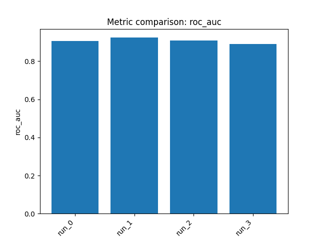

# Chemistry ML Agent Report: `tdcommons/pgp-broccatelli`

## 1) Dataset and task

- **Benchmark:** `tdcommons/pgp-broccatelli`
- **Problem:** Predict **P-glycoprotein (Pgp/ABCB1) inhibition**
- **Target:** Binary label indicating whether a compound is a **Pgp inhibitor** or **not**
- **Task type:** **Binary classification**
- **Primary metric:** **ROC AUC**
- **Data split used:** 973 training molecules and 245 held-out test molecules

**Important note:** In this benchmark run, the reported “validation set” performance corresponds to the benchmark’s **held-out evaluation set** (the test split returned by `get_train_test_split`). All metrics below are therefore on the **held-out evaluation / validation set**.

---

## 2) Approach

We trained **4 different models**, chosen to provide diversity across:
- **Feature representations:** Morgan count fingerprints, Morgan+RDKit descriptor concatenation, RDKit descriptors, and atom-pair fingerprints
- **Model families:** gradient boosting, regularized linear modeling, and tree ensembles

High-level strategy:
1. Start with a strong nonlinear fingerprint baseline.
2. Add physicochemical descriptors to capture ADME-relevant global properties.
3. Test a simpler regularized linear model for robustness and diversity.
4. Try a more orthogonal structural fingerprint representation with a different ensemble model.

All models were **saved** to disk.

---

## 3) Reasoning and decisions

- The dataset is a **moderate-small binary ADME classification** problem, so overfitting is a real concern.
- Because **Pgp inhibition** depends on both **local structural motifs** and broader **molecular properties** (e.g., lipophilicity/cationic behavior), the search included both **fingerprints** and **RDKit descriptors**.
- Since the benchmark metric is **ROC AUC**, models were treated as **probabilistic classifiers**.
- **Run 0** used **Morgan count fingerprints + XGBoost** as a strong nonlinear baseline.
- **Run 1** added **RDKit descriptors** and switched to **LightGBM**, aiming to capture both structural and whole-molecule property effects.
- **Run 2** tested **RDKit descriptors + ridge** to check whether a simpler, regularized model could remain competitive.
- **Run 3** used **atom-pair fingerprints + Extra Trees** to probe a distinct topological representation.

Overall conclusion from iteration history:
- Mixed feature representations (**Morgan + RDKit**) worked best.
- Descriptor-only linear modeling was respectable but not better than boosted mixed features.
- Atom-pair features were useful but weaker than the top fingerprint/descriptor combinations.

---

## 4) Results

### Validation-set performance
All metrics below are on the **held-out evaluation (validation) set**.

| Model ID | Description | ROC AUC | CV Score | Notes |
|---|---|---:|---:|---|
| `run_1` | `morgan_rdkit_concat + lightgbm` | **0.9239** | 0.8879 | Best overall |
| `run_2` | `rdkit_descriptors + ridge` | 0.9080 | — | Strong simple baseline |
| `run_0` | `morgan_counts + xgboost` | 0.9072 | 0.8874 | Strong nonlinear fingerprint model |
| `run_3` | `atom_pair + extra_trees` | 0.8894 | 0.8857 | Most distinct representation, lower performance |

### Per-run details

- **`run_0` — morgan_counts + xgboost**
  - **Validation ROC AUC:** 0.9072247400693149
  - **Best hyperparameters:** `n_estimators=400, max_depth=5, learning_rate=0.1, subsample=0.8, colsample_bytree=0.6, reg_alpha=0.5, reg_lambda=1`

- **`run_1` — morgan_rdkit_concat + lightgbm**
  - **Validation ROC AUC:** **0.9238869634764063**
  - **Best hyperparameters:** `n_estimators=500, max_depth=-1, learning_rate=0.1, subsample=1.0, colsample_bytree=1.0, reg_alpha=0, reg_lambda=0`

- **`run_2` — rdkit_descriptors + ridge**
  - **Validation ROC AUC:** 0.9079578778992268

- **`run_3` — atom_pair + extra_trees**
  - **Validation ROC AUC:** 0.8894294854705411
  - **Best hyperparameters:** `n_estimators=300, max_depth=20`

### Comparison summary

- The **best model** was **`run_1` (Morgan + RDKit + LightGBM)** with **ROC AUC = 0.9239** on the held-out evaluation/validation set.
- **`run_0`** and **`run_2`** were very similar, both around **0.908 ROC AUC**.
- **`run_3`** underperformed the others, suggesting atom-pair features were less effective here than the mixed Morgan+descriptor representation.

---

## 5) Artifacts

### Saved models
- `outputs/run_20260309_062153/artifacts/model_0.joblib`
- `outputs/run_20260309_062153/artifacts/model_1.joblib`
- `outputs/run_20260309_062153/artifacts/model_2.joblib`
- `outputs/run_20260309_062153/artifacts/model_3.joblib`

### Plots

**Run 0**
- `outputs/run_20260309_062153/artifacts/train_target_hist_0.png`
- `outputs/run_20260309_062153/artifacts/test_predictions_hist_0.png`
- `outputs/run_20260309_062153/artifacts/cv_results_0.png`

**Run 1**
- `outputs/run_20260309_062153/artifacts/train_target_hist_1.png`
- `outputs/run_20260309_062153/artifacts/test_predictions_hist_1.png`
- `outputs/run_20260309_062153/artifacts/cv_results_1.png`

**Run 2**
- `outputs/run_20260309_062153/artifacts/train_target_hist_2.png`
- `outputs/run_20260309_062153/artifacts/test_predictions_hist_2.png`

**Run 3**
- `outputs/run_20260309_062153/artifacts/train_target_hist_3.png`
- `outputs/run_20260309_062153/artifacts/test_predictions_hist_3.png`
- `outputs/run_20260309_062153/artifacts/cv_results_3.png`

**Recommended model to use:** `outputs/run_20260309_062153/artifacts/model_1.joblib`

### Metrics comparison

