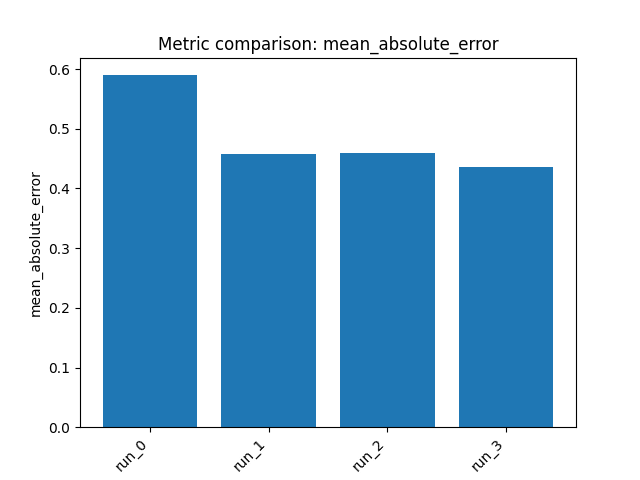

# Chemistry ML Final Report: Polaris ADME Fang Solubility Benchmark

## 1) Dataset and task

- **Benchmark:** `polaris/adme-fang-solu-1`
- **Endpoint / target:** **LOG_SOLUBILITY** (log aqueous solubility)
- **Task type:** **Single-task regression**
- **Dataset size:** 1578 training compounds, 400 held-out evaluation compounds
- **Primary benchmark metric:** **Pearson correlation**

**Note:** The reported “validation set” performance below refers to the benchmark’s **held-out evaluation set** (the test split returned by `get_train_test_split`), per the benchmark setup.

---

## 2) Approach

We trained **4 different regression pipelines** and saved each model artifact.

High-level strategy:
- Start with a **hybrid chemical representation** (Morgan fingerprints + RDKit descriptors) and a regularized linear model.
- Then test **descriptor-based nonlinear boosting** to capture physicochemical effects.
- Next evaluate **fingerprint-based kernel methods** on Morgan count features, since solubility often depends on nonlinear substructure similarity.
- Compare the runs using held-out evaluation-set metrics, with particular attention to **Pearson correlation**.

---

## 3) Reasoning and decisions

- The task is a **medium-sized molecular regression** problem where both **global physicochemical properties** and **local substructure motifs** can influence solubility.
- Because the benchmark optimizes for **Pearson correlation**, the goal is not only low error but also strong agreement in relative ordering/trend on unseen compounds.
- **Run 0:** Began with **Morgan + RDKit concat + ridge** as a robust baseline combining substructure and descriptors.
- **Observation after Run 0:** Linear modeling on the concatenated feature space underperformed, suggesting that the relationship is likely **nonlinear** and/or noisy.
- **Run 1:** Switched to **RDKit descriptors + LightGBM** to model nonlinear dependencies in physicochemical descriptors.
- **Observation after Run 1:** Error improved substantially, but correlation remained moderate; this suggested improved calibration without fully capturing ranking structure.
- **Run 2:** Moved to **Morgan counts + SVR**, targeting nonlinear similarity relationships in substructure space.
- **Observation after Run 2:** Pearson and Spearman improved clearly, indicating count fingerprints plus kernel learning were better aligned with the benchmark objective.
- **Run 3:** Tried **Morgan counts + kernel ridge** as a related kernel-based regressor with a smoother regression surface.
- **Outcome:** This was the strongest model overall on the held-out evaluation/validation set.

---

## 4) Results

### Held-out evaluation (“validation”) set performance

| Model ID | Description | MAE | MSE | Pearson r | Spearman r | R² |
|---|---|---:|---:|---:|---:|---:|
| `run_0` | morgan_rdkit_concat + ridge | 0.5897 | 0.6052 | 0.4470 | 0.3445 | -0.1163 |
| `run_1` | rdkit_descriptors + lightgbm | 0.4580 | 0.4477 | 0.4286 | 0.3835 | 0.1742 |
| `run_2` | morgan_counts + svr | 0.4590 | 0.3989 | 0.5577 | 0.4776 | 0.2643 |
| `run_3` | morgan_counts + kernel_ridge | **0.4366** | **0.3571** | **0.5851** | **0.4976** | **0.3414** |

### Per-run summary

- **`run_0` — morgan_rdkit_concat + ridge**
  - Held-out evaluation/validation metrics: MAE **0.5897**, Pearson **0.4470**
  - Best hyperparameters: `alpha=100.0`

- **`run_1` — rdkit_descriptors + lightgbm**
  - Held-out evaluation/validation metrics: MAE **0.4580**, Pearson **0.4286**
  - Best hyperparameters: `n_estimators=500`, `learning_rate=0.02`, `colsample_bytree=0.7`, `subsample=0.9`, `reg_lambda=5.0`

- **`run_2` — morgan_counts + svr**
  - Held-out evaluation/validation metrics: MAE **0.4590**, Pearson **0.5577**
  - Best hyperparameters: `C=1`, `epsilon=0.1`, `gamma='scale'`

- **`run_3` — morgan_counts + kernel_ridge**
  - Held-out evaluation/validation metrics: MAE **0.4366**, Pearson **0.5851**
  - Best hyperparameters: `kernel='laplacian'`, `gamma=0.001`, `alpha=0.1`

### Comparison and conclusion

- The **best overall model** was **`run_3` (morgan_counts + kernel_ridge)**.
- It achieved the **lowest MAE**, **lowest MSE**, **highest Pearson correlation**, **highest Spearman correlation**, and **best R²** on the held-out evaluation (**validation**) set.
- The results indicate that for this benchmark, **nonlinear models on Morgan count fingerprints** were more effective than the linear hybrid baseline or descriptor-only boosting.

---

## 5) Artifacts

### Saved models
- `outputs/run_20260309_063526/artifacts/model_0.joblib`
- `outputs/run_20260309_063526/artifacts/model_1.joblib`
- `outputs/run_20260309_063526/artifacts/model_2.joblib`
- `outputs/run_20260309_063526/artifacts/model_3.joblib`

### Plots

**Run 0**
- `outputs/run_20260309_063526/artifacts/train_actual_vs_pred_0.png`
- `outputs/run_20260309_063526/artifacts/train_target_hist_0.png`
- `outputs/run_20260309_063526/artifacts/test_predictions_hist_0.png`
- `outputs/run_20260309_063526/artifacts/cv_results_0.png`

**Run 1**
- `outputs/run_20260309_063526/artifacts/train_actual_vs_pred_1.png`
- `outputs/run_20260309_063526/artifacts/train_target_hist_1.png`
- `outputs/run_20260309_063526/artifacts/test_predictions_hist_1.png`
- `outputs/run_20260309_063526/artifacts/cv_results_1.png`

**Run 2**
- `outputs/run_20260309_063526/artifacts/train_actual_vs_pred_2.png`
- `outputs/run_20260309_063526/artifacts/train_target_hist_2.png`
- `outputs/run_20260309_063526/artifacts/test_predictions_hist_2.png`
- `outputs/run_20260309_063526/artifacts/cv_results_2.png`

**Run 3**
- `outputs/run_20260309_063526/artifacts/train_actual_vs_pred_3.png`
- `outputs/run_20260309_063526/artifacts/train_target_hist_3.png`
- `outputs/run_20260309_063526/artifacts/test_predictions_hist_3.png`
- `outputs/run_20260309_063526/artifacts/cv_results_3.png`

If you want, I can also convert this into a shorter executive summary or rank the models specifically by the benchmark’s primary metric only.

### Metrics comparison

