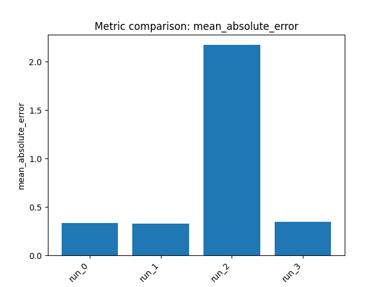

# Final Report: `tdcommons/caco2-wang`

## 1) Dataset and task
- **Benchmark:** `tdcommons/caco2-wang`
- **Target:** **Caco-2 cell effective permeability**, a continuous ADME property used as a proxy for intestinal absorption.
- **Task type:** **Single-task regression**
- **Data split used:** **728 train / 182 held-out evaluation samples**
- **Important note:** In this benchmark, the reported “validation set” performance refers to the **held-out evaluation set** (the test split returned by `get_train_test_split`).

---

## 2) Approach
- **Number of pipelines run:** **4**
- **High-level strategy:** Compare classical molecular ML pipelines appropriate for a small-to-medium regression dataset:
  - Mixed **Morgan fingerprints + RDKit descriptors** with a regularized linear model
  - **RDKit descriptors** with nonlinear gradient boosting models
  - **Morgan count fingerprints** with a kernel method

The main optimization target was **mean absolute error (MAE)**, where **lower is better**.

---

## 3) Reasoning and decisions
- Caco-2 permeability depends on both **global physicochemical properties** (e.g., lipophilicity, polarity, H-bonding, size, charge-related effects) and **substructure patterns**, so both descriptor-based and fingerprint-based featurizations were considered.
- Because the dataset is modest in size, I prioritized **well-regularized classical models** rather than highly flexible deep models.
- **Run 0** used concatenated Morgan + RDKit features with **ridge regression** as a robust baseline for mixed sparse/dense chemical features.
- After that baseline performed reasonably, **Run 1** shifted to **XGBoost on RDKit descriptors** to better capture nonlinear interactions among physicochemical properties relevant to permeability.
- **Run 2** tested whether richer substructure information plus a nonlinear kernel (**kernel ridge on Morgan counts**) would help; it performed poorly, suggesting this setup was not well matched to the benchmark.
- **Run 3** tried **LightGBM** as a complementary boosting approach on RDKit descriptors after XGBoost showed the strongest results.

Overall, the experiments suggest that for this benchmark, **descriptor-based gradient boosting** is more effective than the tested fingerprint/kernel setup, and slightly better than the regularized linear mixed-feature baseline.

---

## 4) Results
**All metrics below are on the held-out evaluation set (“validation set” in your request).**  
Primary metric: **MAE** (**lower is better**)

| Model ID | Pipeline | Validation MAE |
|---|---|---:|
| `run_1` | `rdkit_descriptors + xgboost` | **0.3257** |
| `run_0` | `morgan_rdkit_concat + ridge` | 0.3355 |
| `run_3` | `rdkit_descriptors + lightgbm` | 0.3480 |
| `run_2` | `morgan_counts + kernel_ridge` | 2.1733 |

### Per-run details
- **`run_0` — morgan_rdkit_concat + ridge**
  - **Validation MAE:** `0.3355140489201137`
  - Best hyperparameters: `alpha=100.0`

- **`run_1` — rdkit_descriptors + xgboost**
  - **Validation MAE:** `0.3257405935479804`
  - Best hyperparameters: `n_estimators=500`, `max_depth=7`, `learning_rate=0.03`, `subsample=0.7`, `colsample_bytree=0.6`, `reg_alpha=1.0`, `reg_lambda=10.0`

- **`run_2` — morgan_counts + kernel_ridge**
  - **Validation MAE:** `2.173277431141022`
  - Best hyperparameters: `kernel=rbf`, `gamma=0.0005`, `alpha=0.01`

- **`run_3` — rdkit_descriptors + lightgbm**
  - **Validation MAE:** `0.34800074144000337`
  - Best hyperparameters: `n_estimators=500`, `max_depth=-1`, `learning_rate=0.02`, `subsample=0.9`, `colsample_bytree=0.6`, `reg_alpha=0.0`, `reg_lambda=10.0`

### Comparison
- **Best model:** `run_1` (**RDKit descriptors + XGBoost**), with **validation MAE = 0.3257**
- Ranking: `run_1` > `run_0` > `run_3` >>> `run_2`
- Interpretation:
  - **XGBoost on RDKit descriptors** gave the best held-out performance.
  - **Ridge on concatenated Morgan+RDKit** was competitive and likely more stable/simple.
  - **LightGBM** was close, but slightly behind XGBoost.
  - **Kernel ridge on Morgan counts** substantially underperformed and is not recommended for this dataset based on this run.

---

## 5) Artifacts

### Saved models
- `run_0`: `outputs/run_20260309_075241/artifacts/model_0.joblib`
- `run_1`: `outputs/run_20260309_075241/artifacts/model_1.joblib`
- `run_2`: `outputs/run_20260309_075241/artifacts/model_2.joblib`
- `run_3`: `outputs/run_20260309_075241/artifacts/model_3.joblib`

### Plots
#### `run_0`
- `outputs/run_20260309_075241/artifacts/train_actual_vs_pred_0.png`
- `outputs/run_20260309_075241/artifacts/train_target_hist_0.png`
- `outputs/run_20260309_075241/artifacts/test_predictions_hist_0.png`
- `outputs/run_20260309_075241/artifacts/cv_results_0.png`

#### `run_1`
- `outputs/run_20260309_075241/artifacts/train_actual_vs_pred_1.png`
- `outputs/run_20260309_075241/artifacts/train_target_hist_1.png`
- `outputs/run_20260309_075241/artifacts/test_predictions_hist_1.png`
- `outputs/run_20260309_075241/artifacts/cv_results_1.png`

#### `run_2`
- `outputs/run_20260309_075241/artifacts/train_actual_vs_pred_2.png`
- `outputs/run_20260309_075241/artifacts/train_target_hist_2.png`
- `outputs/run_20260309_075241/artifacts/test_predictions_hist_2.png`
- `outputs/run_20260309_075241/artifacts/cv_results_2.png`

#### `run_3`
- `outputs/run_20260309_075241/artifacts/train_actual_vs_pred_3.png`
- `outputs/run_20260309_075241/artifacts/train_target_hist_3.png`
- `outputs/run_20260309_075241/artifacts/test_predictions_hist_3.png`
- `outputs/run_20260309_075241/artifacts/cv_results_3.png`

**Recommendation:** Use **`run_1`** as the primary saved model for this dataset.

### Metrics comparison

