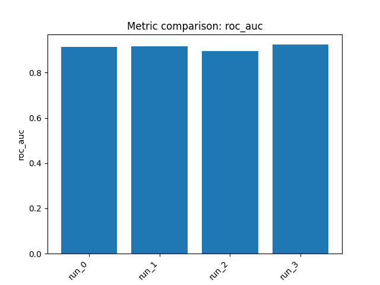

# Final Report: `tdcommons/pgp-broccatelli`

## 1) Dataset and task

**Benchmark:** `tdcommons/pgp-broccatelli`  
**Domain:** ADME / transporter inhibition  
**Target:** Binary label indicating whether a compound inhibits **P-glycoprotein (P-gp / ABCB1)**  
**Task type:** **Binary classification**  
**Primary metric:** **ROC AUC**

The benchmark split used here contains **973 training compounds** and **245 held-out evaluation compounds**. Per your request wording, the reported “validation set” performance is this same **held-out evaluation set** (the test split returned by `get_train_test_split`).

---

## 2) Approach

We trained **4 different models**, saved all of them, and compared their held-out evaluation/validation performance.

**High-level strategy**
- Use complementary cheminformatics representations:
  - **Morgan count fingerprints**
  - **RDKit descriptors**
  - **Morgan + RDKit concatenated features**
- Compare several model families suited to modest-size QSAR classification:
  - **XGBoost**
  - **LightGBM**
  - **Ridge**
  - **Extra Trees**
- Optimize for **ROC AUC**, so models were configured to produce **probability-like scores** rather than hard class labels.

---

## 3) Reasoning and decisions

- This is a **small-to-moderate binary QSAR problem**, so overfitting is a concern; robust classical ML methods are appropriate.
- Because the benchmark metric is **AUROC**, the goal is good **ranking of inhibitors vs non-inhibitors**, not threshold tuning.
- **Morgan fingerprints** were prioritized because P-gp inhibition often depends on recurring substructural motifs and broad SAR patterns.
- **RDKit descriptors** were tested to capture global physicochemical properties relevant to transporter interaction.
- Iteration logic across runs:
  - **Run 0:** Start with a strong baseline: **Morgan counts + XGBoost** for nonlinear SAR.
  - **Run 1:** Add complementary physicochemical information using **Morgan+RDKit + LightGBM**.
  - **Run 2:** Test a more orthogonal, lower-variance baseline: **RDKit descriptors + Ridge**.
  - **Run 3:** After the linear descriptor model underperformed, return to substructure-centric features with a different tree family: **Morgan counts + Extra Trees**.
- Outcome of the search:
  - Tree-based models on **Morgan count fingerprints** were strongest.
  - Adding RDKit descriptors helped somewhat with LightGBM, but not enough to beat the best fingerprint-only tree model.
  - The linear descriptor-only baseline was competitive but clearly weaker than the top tree models.

---

## 4) Results

**All metrics below are on the held-out evaluation set, i.e. the benchmark’s validation set requested by the user.**

| Model ID | Description | Validation ROC AUC | CV Score | Notes |
|---|---|---:|---:|---|
| `run_0` | morgan_counts + xgboost | **0.9143** | 0.8932 | Strong nonlinear fingerprint baseline |
| `run_1` | morgan_rdkit_concat + lightgbm | **0.9174** | 0.8906 | Slight improvement from combined features |
| `run_2` | rdkit_descriptors + ridge | **0.8962** | — | Orthogonal linear baseline; weaker than tree models |
| `run_3` | morgan_counts + extra_trees | **0.9238** | 0.8593 | **Best held-out model** |

### Comparison summary
- **Best model:** `run_3` (**Morgan counts + Extra Trees**) with **ROC AUC = 0.9238**
- Ranking of models by held-out validation ROC AUC:
  1. `run_3` — 0.9238
  2. `run_1` — 0.9174
  3. `run_0` — 0.9143
  4. `run_2` — 0.8962

### Best hyperparameters found
- **`run_0` (XGBoost):**
  - `n_estimators=200`, `max_depth=5`, `learning_rate=0.03`
  - `subsample=0.7`, `colsample_bytree=0.7`
  - `reg_alpha=0`, `reg_lambda=5`
- **`run_1` (LightGBM):**
  - `n_estimators=400`, `max_depth=7`, `learning_rate=0.1`
  - `subsample=0.9`, `colsample_bytree=0.9`
  - `reg_alpha=1.0`, `reg_lambda=0`
- **`run_3` (Extra Trees):**
  - `n_estimators=300`, `max_depth=40`

**Conclusion:** For this dataset, **substructure-focused ensemble tree methods** performed best, with **Extra Trees on Morgan count fingerprints** giving the strongest validation-set ranking performance.

---

## 5) Artifacts

### Saved models
- `outputs/run_20260309_075006/artifacts/model_0.joblib`
- `outputs/run_20260309_075006/artifacts/model_1.joblib`
- `outputs/run_20260309_075006/artifacts/model_2.joblib`
- `outputs/run_20260309_075006/artifacts/model_3.joblib`

### Plots
**Run 0**
- `outputs/run_20260309_075006/artifacts/train_target_hist_0.png`
- `outputs/run_20260309_075006/artifacts/test_predictions_hist_0.png`
- `outputs/run_20260309_075006/artifacts/cv_results_0.png`

**Run 1**
- `outputs/run_20260309_075006/artifacts/train_target_hist_1.png`
- `outputs/run_20260309_075006/artifacts/test_predictions_hist_1.png`
- `outputs/run_20260309_075006/artifacts/cv_results_1.png`

**Run 2**
- `outputs/run_20260309_075006/artifacts/train_target_hist_2.png`
- `outputs/run_20260309_075006/artifacts/test_predictions_hist_2.png`

**Run 3**
- `outputs/run_20260309_075006/artifacts/train_target_hist_3.png`
- `outputs/run_20260309_075006/artifacts/test_predictions_hist_3.png`
- `outputs/run_20260309_075006/artifacts/cv_results_3.png`

### Metrics comparison

